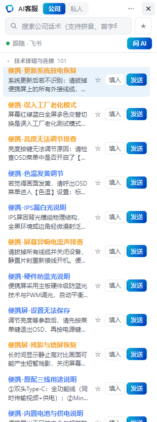
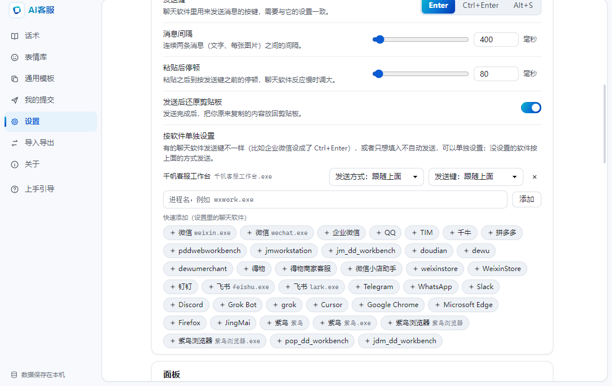

# AI客服

<p align="center">
  <strong>贴在聊天窗口旁边的电商客服 Windows 话术面板与 AI 回复助手</strong>
</p>

<p align="center">
  <a href="https://github.com/yexiu700/ai-kefu-panel/releases/latest"></a>
  <a href="https://github.com/yexiu700/ai-kefu-panel/actions/workflows/ci.yml"></a>
  
</p>

<p align="center">
  <a href="https://github.com/yexiu700/ai-kefu-panel/releases/latest"><strong>⬇ 下载最新 Windows 安装包</strong></a>
  ·
  <a href="#快速开始">快速开始</a>
  ·
  <a href="#从飞书同步公司话术">飞书同步</a>
  ·
  <a href="./ROADMAP.md">迭代路线图</a>
  ·
  <a href="./docs/README.md">开发与架构文档</a>
</p>

---

**AI客服** 是专为电商客服日常高频接待打造的轻量桌面侧边栏：面板自动吸附在当前聊天窗口旁边，窗口挪到哪就跟到哪。常用回复搜一下、点一下（或按快捷键）就能填入或发出；遇到复杂售后与外语咨询，复制买家消息点「问 AI」即可结合本地话术库生成建议回复，确认改好后再发。一套话术同时服务千牛、京麦、拼多多、抖店、得物、紫鸟浏览器、微信、飞书等多个接待台，统一团队口径，降低新人上手成本。

<p align="center">
  
</p>
<p align="center"><sub>侧边话术面板：中文/拼音/首字母检索、一键填入或发送、问 AI 建议回复</sub></p>

<p align="center">
  
</p>
<p align="center"><sub>管理窗口：公司/私人双库管理、按软件定制发送键与发送方式、飞书一键同步</sub></p>

---

## 解决什么痛点

- **新人培训周期长**：商品参数、物流时效、退换规则繁杂，新人记不住容易答错返工。
- **高频问题重复敲字**：「怎么用」「几天发货」「能不能退差价」每天重复输入几十上百次。
- **多平台口径与按键混乱**：千牛、京麦、微信、网页端来回切换，`Enter` 与 `Ctrl+Enter` 极易按错误发。

---

## 核心特性

### 1. 窗口自动跟随与精确贴靠
- **自动识别前台接待窗**：基于原生 Win32 快照与全名精确进程匹配，切到目标接待软件即自动绑定，也可将面板贴靠在聊天窗左侧/右侧同步移动，或手动锁定某一个聊天窗口。
- **内置主流电商与办公软件**：开箱支持千牛、拼多多商家工作台、京麦 / 咚咚、抖店、得物、小红书千帆、微信小店、**紫鸟浏览器**（`紫鸟浏览器.exe` / `紫鸟.exe`）、微信、企业微信、QQ、TIM、钉钉、飞书，以及 Chrome / Edge / Firefox 网页客服台；支持在设置中按进程名自由扩展。

### 2. 毫秒级标题检索与键盘流操作
- **中文 + 全拼 + 拼音首字母**：专注搜索话术标题（完整展示超长标题、绝不截断省略），全拼自动按汉字字首对齐，拼音库在首屏渲染完成后异步加载。
- **输入防抖与盲打秒发**：针对大型公司话术库优化中文输入法合成防抖；支持 `Enter` 立即执行、`Ctrl+Enter` 临时切换「填入 / 发送」、`Alt+1~9` 盲按前 9 条，在面板任意位置直接打字即可进入搜索。
- **单条话术全局热键**：高频话术可绑定专属全局快捷键，身在聊天窗口无需切焦即可一按发送/填入；限定适用软件的分组仅在对应聊天软件下自动激活热键。

### 3. 按软件定制发送规则 + 图文附件混合粘贴
- **按软件独立规则（`appRules`）**：可为京麦、微信、紫鸟等分别指定「直接发送 / 只填入不回车」以及发送键（`Enter` / `Ctrl+Enter` / `Alt+S`）。普通行与常用区点整行均自动跟随当前窗口规则；显式点击右侧「填入 / 发送」按钮则以当次点击为准。
- **图文与文件一键粘贴**：支持文字 + 多张图片 + 附件混合话术。发送时严格遵循**先文字、后媒体**顺序，媒体通过持久化 `CF_HDROP` 文件剪贴板粘贴（发送模式自动留足至少 500 ms 落盘延迟；媒体步骤不覆盖剪贴板，避免丢失待确认文件）。
- **零打扰静默交互**：成功发送、填入、复制与同步均不弹打扰气泡，回读校验细节静默记入本地发送日志；仅在切窗失败、权限不匹配（如京东工作台以管理员运行）、未连接聊天窗或媒体缺失时给出明确提示。

### 4. 「问 AI」智能建议回复（严守隐私边界）
- 在聊天窗选中买家消息按 `Ctrl+C` 复制，点击面板「问 AI」或按全局热键 `Ctrl+Alt+J`，自动检索本地相关话术作为依据并生成推荐回复与备选方案（自动跟随买家语种）。
- 支持在编辑框微调后填入/发送，或点「＋ 收录为话术」沉淀进私人库。
- **隐私承诺**：只读取系统剪贴板文本，**绝不自动截屏、绝不做 OCR、绝不主动读取聊天窗口聊天记录**。

### 5. 飞书公司话术同步与本机数据保护
- **公司 / 私人双库隔离**：支持一键同步飞书多维表格「国内公司主库 / 海外公司主库」，仅替换公司分组，**私人话术与本地收藏/使用次数统计完整保留**。
- **表格导入导出与防损备份**：支持 CSV/表格批量导入导出；保留最近 20 份历史快照备份，若遇断电等导致 `library.json` 损坏，启动时会自动将原文件另存至 `backups/library-corrupt-*.json.bak`，绝不静默丢数据。

---

## 快速开始

### 方式一：安装 Windows 桌面版（推荐）

支持 **Windows 10 / Windows 11 (x64)**：

1. 前往 [**GitHub Releases**](https://github.com/yexiu700/ai-kefu-panel/releases/latest) 下载最新 `AI-Kefu-Setup-x.y.z-win-x64.exe` 安装程序。
2. 双击完成安装并启动 **AI客服**，打开任意支持的聊天工作台即可自动连接。

### 方式二：从源码运行

环境要求：Node.js 20+（推荐 22 LTS）。

```bash
git clone https://github.com/yexiu700/ai-kefu-panel.git
cd ai-kefu-panel
npm install
npm start
```

---

## 快捷键一览

### 全局快捷键（可在「管理 → 设置」中自定义或清空）

| 功能 | 默认快捷键 | 说明 |
| --- | --- | --- |
| 显示 / 隐藏侧边面板 | `Ctrl+Alt+K` | 随时呼出或收起面板 |
| 聚焦面板搜索框 | `Ctrl+Alt+F` | 呼出面板并全选搜索词，直接重输 |
| 问 AI | `Ctrl+Alt+J` | 读取剪贴板中的买家消息生成回复建议 |
| 单条话术快捷发送 | 话术内单独设置 | 按当前聊天软件规则直接发送或填入 |

### 面板内操作快捷键

| 按键 | 作用 |
| --- | --- |
| `↑` / `↓` | 上下切换选中话术 |
| `Enter` | 按当前软件或全局默认方式执行（发送 / 填入） |
| `Ctrl+Enter` | 临时以相反方式执行（默认发送则改为只填入，反之亦然） |
| `Alt+1` ~ `Alt+9` | 直接触发当前列表第 1 ~ 9 条话术 |
| `Esc` | 依次关闭菜单 → 清空搜索词 → 关闭 AI 卡片 |

---

## 进阶配置

### 从飞书同步公司话术

1. 打开「管理话术 → 设置 → 飞书同步配置」，点击 **「导入 feishu.env」** 选择 UTF-8 编码的 `.env` 或文本文件（包含 `AIKEFU_FEISHU_APP_ID` 与 `AIKEFU_FEISHU_APP_SECRET`，兼容分地区 `DOMESTIC_` / `OVERSEAS_` 表配置）。
2. 凭证安全保存在本机 `%USERPROFILE%\.config\ai-kefu-panel\feishu.env`，不会写入 `settings.json`，界面仅展示脱敏后的 App ID。
3. 在面板菜单点击「从飞书同步公司话术」，选择 **国内公司主库** 或 **海外公司主库** 即可同步。

源码环境也可使用命令行脚本交互式导入（隐藏密钥输入）：

```powershell
.\scripts\import-feishu-config.cmd
# 或从安全目录导入已有文件：
.\scripts\import-feishu-config.cmd -EnvFile "C:\安全目录\feishu.env"
```

### 配置「问 AI」模型密钥

可在管理窗口的 AI 设置中填写网关地址、模型与 API Key，或通过以下任一本机方式提供密钥（优先级从高到低）：

1. 系统环境变量：`HUIYOU_LLM_API_KEY`（或 `NEXTOP_LLM_API_KEY`）
2. 本机密钥文件：`%USERPROFILE%\.huiyou\llm_api_key`（纯文本单行 Key）

---

## 本机数据目录与排障

所有话术、媒体与日志均保存在本机，面板右上角 `≡` 菜单提供两个独立入口一键直达：

- **话术与设置目录**（菜单「打开话术与设置目录」）：
  `%APPDATA%\huiyou-original-shell\huiyou-original-shell\`（含 `library.json`、`settings.json`、`media\`、`backups\`）
- **发送诊断日志**（菜单「打开发送日志」）：
  `%APPDATA%\AI客服\logs\send-YYYYMMDD.log`（记录每次激活、耗时、UIA 回读校验状态与未确认原因，单文件超 5 MB 自动轮转）

> **常见排障提示**：若目标软件（如部分京东/咚咚工作台）以管理员身份运行，Windows UIPI 会拦截普通权限进程的按键注入，面板会提示 `elevation-mismatch`，请右键以管理员身份启动 **AI客服**。

---

## 开发、测试与 AI Agent 协作

仓库内置零 GUI 依赖的跨平台沙箱单测体系与双平台 CI，详见以下文档：

- **[`AGENTS.md`](./AGENTS.md)**：项目结构、任务寻址表、核心业务不变量与修改红线。
- **[`docs/architecture.md`](./docs/architecture.md)**：双前端架构、自定义协议（`aikefu://` / `huiyou-media://`）、Koffi 快照与 PowerShell 守护进程设计。
- **[`docs/ipc-contracts.md`](./docs/ipc-contracts.md)**：IPC 全量命令/事件契约与防崩返回结构。
- **[`docs/testing-and-workflow.md`](./docs/testing-and-workflow.md)**：三层测试金字塔、源码切片锚点与 Windows 实机手测清单。

常用开发命令：

```bash
npm test            # 全量 JS 语法检查 + 17 个跨平台隔离单测套件
npm run check       # 仅运行语法检查
npm run test:win    # Windows 下额外运行 PowerShell AST 单测与 Koffi 快照校验
npm run smoke:ui    # Electron 渲染器与自定义协议冒烟测试
npm run dist        # 打包 Windows NSIS 安装程序（输出至 dist/）
```
