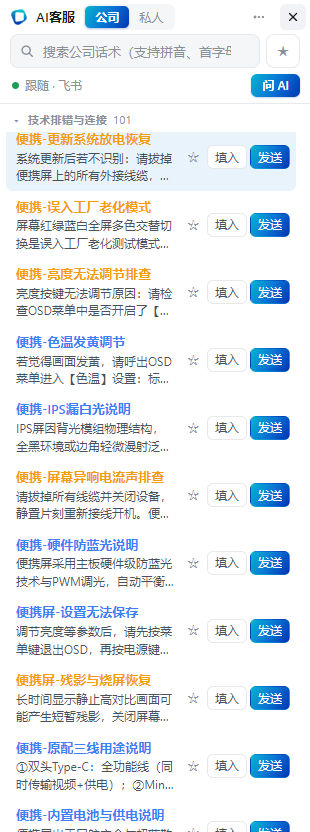
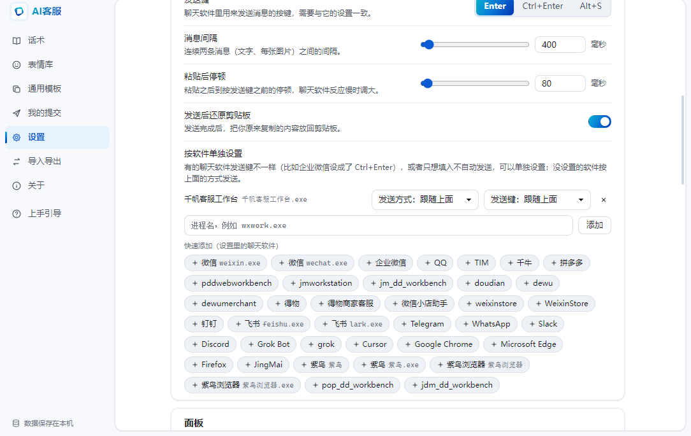

# AI客服

电商客服的桌面话术面板和 AI 助手。

面板贴在聊天窗口旁边，窗口挪到哪就跟到哪。常用回复点一下就能填入或发出去；遇到没把握的问题，点「问 AI」或按热键，先看建议、改完再发。一套话术可用于微信、千牛、拼多多、京东客服工作台、飞书等多个接待窗口，口径统一，新人也能按库来答。

<p align="center">
  
</p>

<p align="center">话术面板：搜索、填入、发送，以及「问 AI」</p>

<p align="center">
  
</p>

<p align="center">管理窗口：发送方式、按软件单独设置，数据保存在本机</p>

## 它解决什么问题

客服团队几乎每天都会碰到这三件事：

- **新人上手慢**：商品多、规则多，要记好几天，答错了还得返工。
- **同样的问题天天答**：「怎么用」「几天发货」「能不能退」，一天要打几十遍。
- **口径不统一**：同一个问题，每个人说法都不一样，说错了就是售后。

AI客服把已经验证过的回复放进一个随时能点的面板里：谁来接待，都按同一套话术和规则来答。

## 主要功能

### 点一下，话术就发出去

- 自动跟随当前聊天窗口，也可以固定在屏幕一侧。
- 支持只填进输入框，或填入后直接发送。
- 中文、拼音、首字母都能搜；常用话术可设热键，一按就发。
- 面板填入或发送话术时支持文字、图片及附件。文字先按原规则处理，随后将图片和附件作为 Windows 文件列表粘贴；请核对目标聊天窗口是否已接收。独立表情库的发送尚未接通。

### 问 AI，确认后再发

遇到不会答的问题，点面板上的「问 AI」，或按 `Ctrl+Alt+J`。AI 会根据当前对话给出回复建议，你可以改完再点发送。AI 只给建议，不会自己给买家发消息。

### 公司话术统一管理

- 公司话术和私人话术分开存放，互不干扰。
- 可从飞书公司话术主库同步，国内组、海外组二选一，同步只更新公司库，私人话术留在本地。
- 支持按表格格式导入、导出话术（归属、分组、二级分类、标题、内容、标题颜色、热键）。
- 话术和使用数据都保存在本机。

### 发送更稳，也能核对结果

不同聊天软件的发送键不一样，可以在设置里统一指定，或按软件单独配置。还可以设置：

- 消息间隔，避免连发太快
- 粘贴后稍等再按发送，给反应慢的窗口留出时间
- 发送后还原剪贴板
- 打开发送日志，查看这次填入或发送有没有成功；如果无法回读输入框，日志会标明无法校验，而不是直接显示成功

带媒体的话术会先处理文字，再粘贴本机媒体目录中已保存的真实文件（CF_HDROP / FileDropList）；部分文件缺失或无权访问时，会说明中文原因并继续处理其余可用文件。图片以文件方式粘贴，接收方式取决于聊天软件，当前不提供位图回退。填入模式不会主动按发送键；发送模式会沿用设置的发送键，媒体粘贴后至少等待 1.5 秒或配置的粘贴延迟（取较大值）。部分软件仍会弹出图片/文件确认窗口，需要人工核对。

媒体无法回读确认时，发送日志标记为 `unavailable`，不会声称已收到图片或附件。此时媒体保留在剪贴板，媒体步骤不执行还原剪贴板，以免覆盖尚未读取的文件；纯文字仍沿用原有设置。未绑定聊天窗时只复制媒体并提示手动粘贴，混合话术的文字需另行复制。京东工作台媒体粘贴前会尝试确认或聚焦可识别的输入控件；无法安全识别时停止自动粘贴并提示先点击输入框，不按坐标盲点。

## 支持的聊天软件

默认可用于微信、企业微信、QQ、TIM、千牛、拼多多、京麦 / 京东客服工作台、抖店、得物、微信小店、钉钉、飞书、千帆客服工作台，以及 Chrome、Edge 等常见窗口。也可以在设置里按进程名自行添加。

## 使用方法

### 安装

支持 Windows 10 / 11。安装打包好的「AI客服」安装程序，或从源码启动：

```bash
npm install
npm start
```

打包 Windows 安装包：

```bash
npm run dist
```

### 常用热键

| 功能 | 默认热键 |
| --- | --- |
| 显示 / 隐藏面板 | `Ctrl+Alt+K` |
| 聚焦搜索框 | `Ctrl+Alt+F` |
| 问 AI | `Ctrl+Alt+J` |

热键可在管理窗口的设置里修改。管理窗口可从面板进入，或从托盘菜单打开。

### 从飞书同步公司话术

1. 在管理窗口进入「设置 → 飞书同步配置」，点击「导入 feishu.env」选择 UTF-8 的 `.env` 或文本配置文件（含 `AIKEFU_FEISHU_APP_ID` / `AIKEFU_FEISHU_APP_SECRET`，也支持旧凭证别名）。安装版可直接使用，无需项目脚本。配置写入 `%USERPROFILE%\.config\ai-kefu-panel\feishu.env`，不写入 settings.json。状态只显示遮蔽的 App ID 和密钥是否已配置，导入后当前进程可立即同步。应用需要有对应多维表格的读取权限。
2. 选择同步「国内公司主库」或「海外公司主库」。上次的选择会被记住，也可用于启动时自动同步。
3. 同步只会替换本地的公司话术分组，私人话术不会被覆盖。

源码用户可备选在项目目录双击 `scripts\import-feishu-config.cmd`，或在 PowerShell 中运行（省略 App ID / App Secret 时会提示输入）：

```powershell
.\scripts\import-feishu-config.cmd -AppId "你的 App ID" -AppSecret "你的 App Secret"
.\scripts\import-feishu-config.cmd -EnvFile "C:\安全目录\feishu.env"
```

建议直接运行脚本并隐藏输入密钥，避免密钥留在命令历史中。重复导入会更新凭证并保留其他配置；可选参数 `-DomesticBaseToken`、`-DomesticTableId`、`-OverseasBaseToken`、`-OverseasTableId` 只更新明确提供的地区配置，也支持从文件导入已有的分地区配置。不要把含凭证的文件放入项目或提交到 Git；系统环境变量中的配置优先于此文件；设置页导入会刷新当前进程中已有的别名，下次启动仍按系统环境变量优先。请同步更新或移除过期的系统变量。导入先完整写入同目录临时文件再替换，失败保留原配置；中断可能留下含凭证的 `.tmp` 文件，备用脚本覆盖时还会保留同目录 `.bak` 备份，请按密钥文件保管。

## 数据与发送安全

- 话术库和设置默认只存在这台电脑上，不登录也能用面板搜话术、填入和发送。
- 发给买家的每一句，都要客服点「填入」或「发送」才会出去；AI 推荐同样需要确认。
- 请勿把飞书密钥或大模型密钥写进仓库或发给别人。

## 项目信息

- 产品名：AI客服
- 仓库：[yexiu700/ai-kefu-panel](https://github.com/yexiu700/ai-kefu-panel)
- 运行环境：Windows 10 / 11
