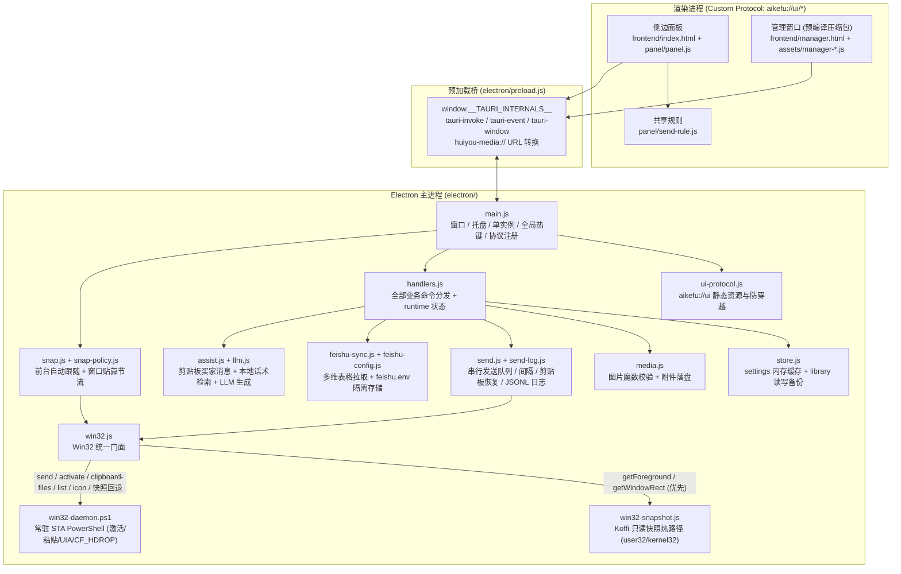

# 架构与数据模型 (`docs/architecture.md`)

本文档面向 AI Agent 与维护者，提供 **AI客服 (`ai-kefu-panel`)** 的全链路架构、数据存储契约、Win32 双通道桥接与打包约束。日常改代码前请先阅读根目录 [`AGENTS.md`](../AGENTS.md)。

---

## 1. 架构演进与「Tauri-on-Electron」双前端设计

本项目源自原版 Tauri 桌面端（历史内部代号 `huiyou`），现运行在纯 Node/Electron 壳（`electron/`）之上：

1. **Tauri 兼容桥（`electron/preload.js`）**：向渲染进程注入 `window.__TAURI_INTERNALS__`、`window.isTauri = true`、`window.__HUIYOU_SHELL__`，并将 `[data-tauri-drag-region]` 映射为 Electron 的 `-webkit-app-region: drag`。
2. **双前端共存（严禁改错入口）**：
   - **日常侧边面板（主力迭代区）**：`frontend/index.html` → 加载 `frontend/panel/send-rule.js` 与 `frontend/panel/panel.js`（原生 JS，无构建步骤，直接改源码生效）。拼音库 `frontend/panel/vendor/pinyin-pro.js` 在首屏渲染完成后通过双 `requestAnimationFrame` + `requestIdleCallback` 延迟加载。
   - **管理窗口（编译产物，谨慎微调）**：`frontend/manager.html` → 加载 `frontend/assets/manager-DBuMfWSZ.js`、`GuideSpotlight-Bc_qirTp.js`，并在切换到「模板库」时按需懒加载 `TemplatesPage-BlVodupk.js` + CSS。仓库内**不含**管理端原始 Vue 源码，因此不要格式化压缩包，主进程命令返回结构必须严格兼容原版前端。
   - **废弃旧面板（禁止修改）**：`frontend/index.legacy.html` 与 `frontend/assets/index-CXzEw6Jt.js` / `index-DB1mh-Ir.css` 仅为历史解包留存（部分旧包校验脚本会核对文件存在性，不要删除，但也不要在上面开发新功能）。
3. **跨进程共享规则模块**：`frontend/panel/send-rule.js` 同时被浏览器 `<script>`（挂载 `window.SendRule`）和主进程 `require('../frontend/panel/send-rule')` 引用，必须保持纯 JS 无 Node/DOM 顶层依赖。

---

## 2. 自定义协议与安全边界

主进程在 `app.whenReady()` 之前通过 `protocol.registerSchemesAsPrivileged` 注册两个特权协议（替代早期 localhost HTTP 服务）：

| 协议 | 处理位置 | 用途与安全规则 |
| --- | --- | --- |
| `aikefu://ui/<path>` | `electron/ui-protocol.js` | 加载 `frontend/` 下所有 HTML/JS/CSS/JSON/字体资源。强制校验 `host === 'ui'`、仅允许 `GET`/`HEAD`、拒绝 `\` / `:` / `\0` / `..` 及目录越界访问（返回 `403`）。 |
| `huiyou-media://localhost/?p=<name_or_path>` | `electron/main.js` (`registerMediaProtocol`) | 渲染话术图片缩略图与附件读取。新数据保存纯文件名（在 `media/` 与 `stickers/` 下查找并校验 `p === path.basename(p)`），同时兼容历史数据中的本机绝对路径。 |

---

## 3. 本机文件与数据目录契约（严禁改动路径）

> [!CAUTION]
> 已安装用户的真实资产依赖以下精确路径，**禁止**重命名 `huiyou-original-shell`、禁止消除双层嵌套目录、禁止迁移存储位置。

| 数据项 | Windows 实际路径 | 读写模块 | 说明 |
| --- | --- | --- | --- |
| 话术库 | `%APPDATA%\huiyou-original-shell\huiyou-original-shell\library.json` | `electron/store.js` | 原子写入（`.tmp` + `renameSync`）；保存前自动备份（`origin === 'panel-usage'` 仅记次数时跳过备份）。 |
| 应用设置 | `%APPDATA%\huiyou-original-shell\huiyou-original-shell\settings.json` | `electron/store.js` | 带 `mtimeMs:ctimeMs:size` 内存缓存，避免吸附轮询每 tick 读盘；返回 `structuredClone` 防止外部篡改缓存。 |
| 话术备份 | `%APPDATA%\huiyou-original-shell\huiyou-original-shell\backups\library-*.json` | `electron/store.js` | 默认保留最近 20 份（飞书同步前调用 `backupNow(Infinity)` 全量保留）。 |
| 本地媒体 / 表情 | `%APPDATA%\huiyou-original-shell\huiyou-original-shell\{media,stickers}\` | `electron/media.js` | 文件名格式 `<UUID>-image.<ext>` 或 `<UUID>-<安全原文件名>`。 |
| 发送诊断日志 | `%APPDATA%\AI客服\logs\send-YYYYMMDD.log` | `electron/send-log.js` | JSONL 格式，单文件超 5MB 轮转为 `.1`。仅记录 `textPreview`（前 40 字）与耗时/状态，不记录聊天窗隐私内容。 |
| 飞书凭证配置 | `%USERPROFILE%\.config\ai-kefu-panel\feishu.env` | `electron/feishu-config.js` | 权限 `0o600` 临时文件 `fsync` 后原子替换。**绝不写入 `settings.json`**；IPC 与界面仅暴露脱敏 App ID。 |
| LLM API Key | 环境变量 `HUIYOU_LLM_API_KEY` / `NEXTOP_LLM_API_KEY` 或 `%USERPROFILE%\.huiyou\llm_api_key` 等 | `electron/assist.js` + `llm.js` | 按环境变量 → 本地密钥文件候选列表顺序解析。 |
| 默认公司话术种子 | `frontend/panel/default-company-library.json`（与 `data/default-company-library.json` 同内容） | `frontend/panel/panel.js` | 首次启动且公司话术数为 0 时自动灌入，或空状态点「导入默认公司话术」加载。若更新种子请同步两处或以 `frontend/panel/` 为准。 |

### 核心数据结构速览

- **`library.json`**：
  - `version`: `1`
  - `groups[]`: `{ id, name, color, scope: 'company' | 'private', apps: [], sections: [{ id, name }], phrases: [...] }`（历史 `'team'` 会在 `normalizeGroup` 中归一为 `'company'`）。
  - `phrases[]`: `{ id, title, content, titleColor, images: string[], files: string[], hotkey, favorite: boolean, section: string|null, useCount: number, lastUsedAt: number|null, createdAt, updatedAt }`。
    - 飞书同步生成的话术 ID 固定为 `feishu:<record_id>`，重同步时据此保留本地 `favorite`、`useCount`、`lastUsedAt`、`createdAt`。
- **`settings.json`**：
  - `send`: `{ mode: 'send'|'fill', key: 'enter'|'ctrl_enter'|'alt_s', intervalMs: 400, pasteDelayMs: 80, restoreClipboard: true, appRules: [{ exe, mode, key }] }`
  - `panel`: `{ docked: false, dockedTouched?: boolean, side: 'left'|'right', width: 300, floatX, floatY, floatWidth: 320, floatHeight: 832, heightTouched?: boolean, alwaysOnTop: true, autoBind: true, chatApps: string[], showPreview: true, hoverPreview: true }`
  - `hotkeys`: `{ togglePanel: 'Ctrl+Alt+K', focusSearch: 'Ctrl+Alt+F', assist: 'Ctrl+Alt+J' }`
  - 飞书元数据：`feishuLibraryRegion` (`'domestic'|'overseas'`)、`feishuSyncOnLaunch`、`feishuLastSyncAt`、`feishuLastSyncMessage`。

---

## 4. Win32 双通道桥接与窗口吸附 / 发送流水线

### 4.1 吸附与跟随轮询（`electron/snap.js` + `snap-policy.js` + `win32-snapshot.js`）

- 定时器基础步长 `280ms`（重入保护 `busy` 标志）：
  - **可见且开启贴靠（`docked && visible`）**：每 `280ms` 轮询前台窗口或刷新锁定窗口矩形，计算贴靠坐标并 `panel.setPosition(x, y, false)`。
  - **隐藏或浮动模式（`!docked || !visible`）**：暂停目标矩形刷新与窗口移动；若开启 `autoBind` 且未锁定（`!pinned`），前台检测节流至 `>= 1000ms` 一次；若 `autoBind === false`，完全跳过系统快照调用。
- **Koffi 只读快照热路径（`electron/win32-snapshot.js`）**：
  - 固定依赖预编译包 `koffi@3.3.8`，直接调用 `user32.dll` / `kernel32.dll` 获取 `hwnd / title / exe / pid / rect / visible / iconic`。
  - 调用 `GetWindowRect` 前临时执行 `SetThreadDpiAwarenessContext(-1)` 并立即在 `finally` 恢复，确保与 PowerShell daemon 的 DPI-unaware 坐标空间完全一致。
  - 若 Koffi 加载失败或高权限进程路径不可读（`pid && !processName`），自动降级回退到 `win32-daemon.ps1`。

### 4.2 串行填入 / 发送流水线（`electron/send.js` + `win32-daemon.ps1`）

所有剪贴板写入与模拟按键均通过 `send.js` 内的单链 `Promise` 队列串行执行，杜绝并发串台：

1. **前置间隔控制**：仅在连续发送时，于写剪贴板前补足距离上次结束的 `intervalMs`（默认 `400ms`）；单次发送无尾等待。
2. **混合话术顺序（铁律：先文字、后媒体）**：
   - 先发送文字（带 `focusInput: true`）；若文字失败立即中止并返回错误。
   - 再由 `media.preparePhraseMedia()` 校验本地媒体目录路径、可读权限与图片文件头魔数，交由 daemon `clipboard-files` 写入持久化 `CF_HDROP`（`FileDropList`），记录 `clipboardSequence`。
3. **窗口激活与安全校验（`win32-daemon.ps1`）**：
   - 若目标 `hwnd` 已失效，尝试按同名 `exe`（或京麦/咚咚工作台特征）自动重绑（`rebound = true`）并通知前端更新目标。
   - 检查自身与目标进程提权状态：若目标以管理员运行而本应用未提权，立即返回 `elevation-mismatch` 中文指引。
   - 已在前台时 `0ms` 直通；不在前台时通过 `ALT` 释放前台锁 + `SetForegroundWindow` 重试最多 3 次（每次 `25ms`）。
   - 粘贴前二次核对前台窗口未切走、媒体剪贴板序列号未被外部程序覆盖；京麦/咚咚媒体粘贴前通过 UIA 精确聚焦唯一消息输入框（绝不按屏幕坐标盲点）。
4. **粘贴回读与发送键**：
   - `SendKeys('^v')` 后进入 `Wait-PasteResult`：纯文字按 `max(80, delayMs)` 预算每 `25ms` 用 UIA `ValuePattern` / `TextPattern` 回读前缀（默认 `<=80ms` 一旦 `match` 立即提前结束）；媒体无法 UIA 回读，固定等待 `max(500, delayMs)` 并标记 `verify = 'unavailable'`。
   - 若 `verify === 'mismatch'`，拒绝按发送键并保留剪贴板内容供人工粘贴。
   - 仅当 `mode === 'send'` 且前台未变时，按解析后的软件发送键（`{ENTER}` / `^{ENTER}` / `%s`）。
5. **剪贴板恢复策略**：
   - 纯文字且已绑定窗口：确认 `match` 时立即恢复原文本剪贴板；`unavailable/skipped` 额外宽限 `50ms` 后恢复。
   - **媒体步骤、发送失败、或未绑定窗口（`clipboard-only`）**：**绝不恢复剪贴板**，确保用户或聊天软件仍能读取剪贴板中的文件/兜底文本。

---

## 5. 问 AI 与飞书同步设计要点

- **问 AI（`electron/assist.js` + `llm.js`）**：
  - **只读系统文本剪贴板**，绝不截屏、绝不通过 UIA 读取聊天记录。
  - 从本地话术库检索 Top-5 相关话术作为参考上下文（`retrieveEvidence`），请求网关优先走 `/responses` 接口（支持 429/5xx 重试），失败自动回退 `/chat/completions`。
  - 输出强制跟随买家语言，面板支持主推回复 + 备选切换、二次编辑、`Ctrl+Enter` 发送，以及「＋ 收录为话术」（并入第一个 `private` 分组，自动清理历史遗留的 `AI 收录` 杂项分组）。
- **飞书同步（`electron/feishu-sync.js` + `feishu-config.js`）**：
  - 支持 `domestic`（国内）与 `overseas`（海外）双主库预设，各区域 Base/Table 配置严格隔离不混用。
  - 凭证优先级：进程环境变量（`HUIYOU_FEISHU_*` / `AIKEFU_FEISHU_*`） > `~/.config/ai-kefu-panel/feishu.env` > `settings.json` 旧字段。
  - 仅同步「归属」为公司（或空）且「内容」非空的行；同步落盘前重新读取最新本地库，**完整保留所有 `private` 分组与表情**，并按稳定 ID `feishu:<record_id>` 继承本地收藏与使用统计。

---

## 6. 打包与 ASAR 解包约束

`package.json` 的 `build` 段配置了 `asar: true`，以下两类文件**必须**保留在 `build.asarUnpack` 中，否则安装包在 Windows 上无法运行：

1. `electron/win32-daemon.ps1`：`powershell.exe -File` 无法读取 `app.asar` 内部脚本，`electron/win32.js` 会自动将 `app.asar` 替换为 `app.asar.unpacked`。
2. `node_modules/@koromix/koffi-win32-x64/**/*`：原生 `.node` 动态库必须解包到磁盘方可被 Electron 加载。
